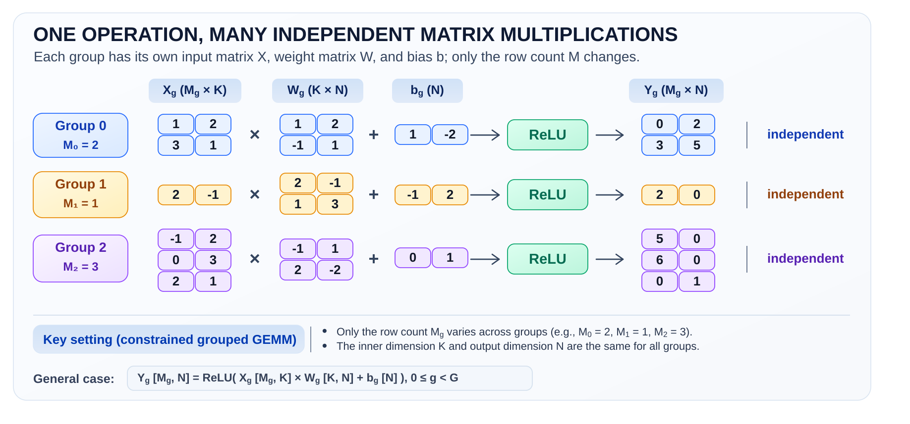
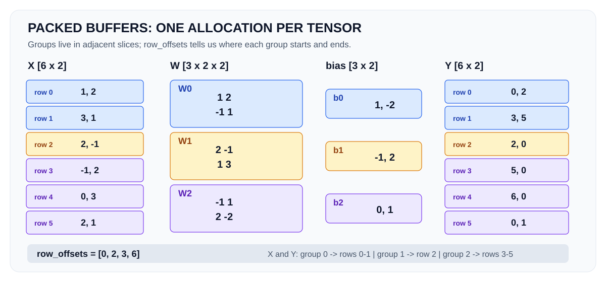
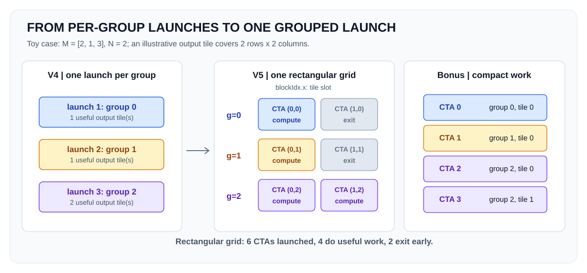

# HPCA 2026: GPU Grouped GEMM Optimization

**From memory coalescing to register reuse, operator fusion, and irregular GPU work scheduling.**

In the [HPCA 2026 profiling tutorial](https://github.com/shwetaiisc/hpca-tutorial-2026), you studied how data movement and the GPU memory hierarchy affect matrix multiplication. This assignment asks you to apply those ideas to a related but more realistic problem: **many matrix multiplications of unequal sizes**, followed by a pointwise operation.

You will implement **five progressively optimized CUDA variants**. Each variant must retain the improvements of the previous one. Use Nsight Systems and Nsight Compute (as required) to explain the observed performance. The objective is not merely to obtain one fast kernel, but to understand **why an optimization works, when it does not, and what the hardware is doing**.

> **Submission:** Submit exactly two files: `grouped_gemm_kernels.cu` (your CUDA implementation) and `report.pdf` (your performance analysis). You must implement all required variants by modifying only `grouped_gemm_kernels.cu`. ***Do not modify any other files in the provided repository.***
> 
> Before starting the assignment, read the [assignment requirements](ASSIGNMENT.md) and [input contract](docs/INPUT_CONTRACT.md) as well.
---

## 1. Motivation: beyond a single square GEMM

A conventional GEMM computes one matrix product. Many machine-learning workloads instead contain multiple independent GEMMs. For example, in a Mixture-of-Experts (MoE) model, tokens are routed to different experts, each with its own weight matrices. Consequently, each expert may receive a different number of tokens: some groups may be tiny or even empty, while others may be much larger.

**Note (Optional Reading):** Understanding MoE is not required for this assignment. For curious readers, [IBM Technology's introductory video](https://www.youtube.com/watch?v=sYDlVVyJYn4) explains MoE, while the [NVIDIA Transformer Engine documentation](https://nvidia.github.io/TransformerEngine/features/mixture_of_experts/mixture_of_experts.html#grouped-gemm) shows how grouped GEMM is used in practice.

In this assignment, group `g` computes

$$
Y_g = \operatorname{ReLU}(X_g W_g + b_g), \qquad 0 \leq g < G.
$$

The bias is broadcast across the rows of the matrix product, and `ReLU(x) = max(0, x)`.

To keep the problem manageable while retaining the key challenges of grouped GEMM, this assignment focuses on a **constrained form of grouped GEMM**, as illustrated in Figure 1.



*Figure 1: Illustration of grouped GEMM. Each group performs an independent matrix multiplication with its own weights and bias. The groups may process different numbers of input rows.*

### What makes this grouped GEMM constrained?

Fully general grouped GEMM allows every group to have different $M$, $N$, and $K$. Here, **only the number of input/output rows changes by group**:

| Tensor | Shape of group $g$ | Constraint |
|---|---|---|
| Input $X_g$ | $M_g \times K$ | $M_g$ may vary, including zero |
| Weights $W_g$ | $K \times N$ | $K$ and $N$ are common to all groups; weights differ |
| Bias $b_g$ | $N$ | A separate bias for each group |
| Output $Y_g$ | $M_g \times N$ | Same row count as this group's input |

All tensors use **FP32**, contiguous **row-major** storage. You do **not** need Tensor Cores, Hopper/Blackwell instructions, expert routing, data packing, pointer-array APIs, or host/device memory transfers. Input generation and packing are handled by the supplied [`src/input_generator.cpp`](src/input_generator.cpp), which is called by the benchmark driver [`src/main.cu`](src/main.cu).

The optimization challenge therefore has two parts: **compute each GEMM efficiently** and **handle unequal amounts of work across groups efficiently**.

## 2. A small running example

Let $G = 3$, $K = N = 2$, and $(M_0, M_1, M_2) = (2, 1, 3)$.

The three groups have independent weights and biases. The matrices and results for this exact example are shown in the figure above, including negative values removed by ReLU. The packed result is

$$
Y = \begin{bmatrix}
0 & 2 \\
3 & 5 \\
2 & 0 \\
5 & 0 \\
6 & 0 \\
0 & 1
\end{bmatrix}.
$$

The first two rows belong to group 0, the next row to group 1, and the final three rows to group 2. This example can be run directly with `--case=toy --verify`.

### Why are the inputs packed?

Rather than an array of pointers to many independently allocated matrices, the driver provides **one contiguous GPU allocation for each tensor**. It also provides `row_offsets`, which identifies each group's rows inside the packed `X` and `Y` buffers.



*Figure 2: Packed memory layout for grouped GEMM. The input and output rows of all groups are stored contiguously, with `row_offsets` identifying group boundaries. Each group has its own weight matrix and bias vector.*

For the toy example, `row_offsets = [0, 2, 3, 6]`. In general:

| Provided buffer | Logical shape |
|---|---|
| `X` | `[sum_g (M_g), K]` |
| `W` | `[G, K, N]` |
| `bias` | `[G, N]` |
| `row_offsets` | `[G + 1]` |
| `Y` | `[sum_g (M_g), N]` |
| `Z` | `[sum_g (M_g), N]`, temporary GEMM output for baseline/V1-V3; absent for V4/V5 |

The buffers are fully allocated and initialized by the harness. No student code is required for packing, allocation, or input transfers. See [the precise contract](docs/INPUT_CONTRACT.md) for layout, supported shapes, determinism, and corner cases.

---

## 3. Five required variants: one optimization at a time

The supplied [`baseline`](src/baseline.cu) is deliberately inefficient. It computes a GEMM result and then applies Bias + ReLU separately for each nonempty group. **Implement V1-V5 in order, retaining each preceding optimization.** The requirements below describe the *performance objectives*, not a prescribed kernel algorithm.

### V1 - Global-memory access locality

Improve the mapping of work to threads so that neighboring lanes access global memory efficiently. Pay particular attention to **coalesced accesses** when reading matrix operands and writing results. Preserve the baseline's separate GEMM and Bias + ReLU stages.

**Investigate:** Does the access pattern of a warp match the memory layout? How does the number of memory transactions and execution time change?

### V2 - On-chip memory and data reuse

Build on V1 by exploiting the GPU's **shared memory** to reduce redundant accesses to global memory. Decide which data can be reused across threads, and how to organize that reuse without introducing avoidable contention or bank conflicts.

**Investigate:** How do global-memory traffic, shared-memory behavior, tile dimensions, and execution time change relative to V1?

### V3 - Register-level locality

Build on V2 by increasing useful reuse inside a thread with **register tiling**. Explore computing multiple nearby output values per thread rather than treating each output independently. Choose your own work decomposition and explain its trade-offs.

**Investigate:** What is the effect on register count, instruction-level parallelism, occupancy, possible spills, and achieved throughput?

### V4 - Operator fusion

Keep V3's optimized GEMM computation, but **fuse Bias + ReLU** into the GEMM rather than launching a separate pointwise kernel. Eliminate the need to keep the intermediate matrix `Z` in global memory.

**Investigate:** What is saved in memory traffic and kernel launches? How does fusion behave for small versus larger groups?

### V5 - Group-aware execution in one launch

Keep V4's optimized, fused computation, but replace its repeated per-group launches with **one CUDA kernel launch covering all nonempty groups**. Groups require unequal numbers of output tiles. The kernel must assign work correctly, respect all boundaries, and handle groups with no rows.

**Investigate:** When does reducing launch overhead help? When does a group-aware launch introduce scheduling waste or underutilization?

### How the launches evolve (conceptual pseudocode)

The first three variants retain the same high-level sequence as the baseline:

```text
for each nonempty group g:
    launch GEMM(g) -> Z_g
    launch BiasReLU(Z_g, b_g) -> Y_g
```

After fusion (V4):

```text
for each nonempty group g:
    launch FusedGEMM_BiasReLU(g) -> Y_g
```

After grouping (V5):

```text
launch GroupedFusedGEMM(all groups) -> packed Y
```

This describes **what** must change; selecting the thread mapping, tiling, memory layout, kernel arguments, and CTA schedule is part of your work.

### Why group sizes matter in V5

Consider the same toy example, where the three groups have $(M_0=2)$, $(M_1=1)$, and $(M_2=3)$, with $(N=2)$. Suppose each CUDA thread block (CTA) computes a `2 × 2` output tile.

- **Group 0:** Output size `2 × 2` → 1 CTA.
- **Group 1:** Output size `1 × 2` → 1 CTA (partially filled tile).
- **Group 2:** Output size `3 × 2` → 2 CTAs.

Thus, the groups require **1, 1, and 2 useful CTAs**, respectively.

In V4, each group is launched separately, using exactly the number of CTAs it needs. In V5, all groups must execute in a single kernel launch. A straightforward approach is to launch a rectangular grid that accommodates the largest group. Since the largest group requires 2 CTAs, this results in **3 groups × 2 CTAs = 6 CTAs**, although only 4 have useful work. The remaining 2 CTAs correspond to excess tiles in Groups 0 and 1.



*Figure 3: CTA scheduling for grouped GEMM. V4 uses separate kernel launches for each group. V5 combines all groups into one rectangular grid, potentially introducing inactive CTAs. The optional bonus explores compact scheduling that avoids these unnecessary CTAs.*

A correct implementation must handle such excess CTAs without invalid memory accesses. **For the optional bonus**, investigate ways to avoid launching unnecessary CTAs altogether. The figure illustrates the scheduling challenge without prescribing a particular implementation.

**Required:** V1–V5. **Optional bonus:** More efficient grouped scheduling without the rectangular grid's inactive CTAs. Detailed, discovery-oriented requirements appear in [ASSIGNMENT.md](ASSIGNMENT.md).

---

## 4. Correctness, experiments, and submission

All variants must compute the same result for the public and additional valid inputs, including **unequal group sizes, empty groups, and dimensions that do not divide evenly into tile sizes**. The checker uses an FP32 tolerance; bitwise identity is not required.

Evaluate **different workload regimes** rather than optimizing only one square matrix. At minimum, analyze small groups, balanced groups, and highly skewed groups. Use **Nsight Systems** to study launch behavior and **Nsight Compute** to study memory, occupancy, and register usage, where those tools support the assigned GPU. Do not infer a bottleneck from execution time alone.

Your PDF should discuss the implementation decisions and include correctness evidence, per-variant timing comparisons, meaningful profiler observations, and explanations for regressions as well as improvements. The measured time must include all kernels that belong to the variant, not only the GEMM kernel.

Submit exactly:

```text
<last_5_digits_of_SR_ID>/
  grouped_gemm_kernels.cu
  report.pdf
```

Do not submit the provided driver, headers, reference, compiled binary, or profiler raw files. Administrative details (deadline, submission platform, grading weights) will be announced shortly.

---

## 5. Quick start

```bash
# Build the supplied benchmark.
make

# Verify the deliberately unoptimized baseline on the numerical example.
./grouped_gemm --case=toy --impl=baseline --verify

# Run a larger irregular workload.
./grouped_gemm --case=small --impl=baseline --iters=10 --verify

# Implement V1-V5 in src/grouped_gemm_kernels.cu.
# Until implemented, a variant reports NOT IMPLEMENTED (not a false PASS).
./grouped_gemm --case=toy --impl=v1 --verify

# Check the CPU input generator without requiring CUDA hardware.
make test-inputs
```

For a GPU architecture that needs an explicit target, for example:

```bash
make clean && make ARCH=75
```

Choose the `ARCH` value for the **actual GPU and installed CUDA toolkit**; do not blindly use the example value.

## 6. Project structure

```text
hpca-grouped-gemm-assignment-2026/
├── README.md                    # Motivation and quick start
├── ASSIGNMENT.md                # Required variants and report rubric
├── Makefile
├── include/
│   ├── grouped_gemm.h           # Fixed CUDA kernel-launch interface
│   └── input_generator.h        # Host-side data contract
├── src/
│   ├── grouped_gemm_kernels.cu  # ONLY student-editable and submitted file
│   ├── baseline.cu              # Deliberately inefficient reference baseline
│   ├── main.cu                  # CLI, GPU allocation, correctness, timing
│   ├── input_generator.cpp      # Reproducible data and shapes
│   └── reference.cpp            # CPU numerical reference
├── figures/                     # Diagrams used in this README
│   ├── overview.svg
│   ├── packed-layout.svg
│   └── scheduling.svg
├── docs/
│   └── INPUT_CONTRACT.md        # Exact test-case and input specification
├── scripts/
│   └── check_all.sh             # Run correctness tests for all variants
└── tests/
    └── test_inputs.cpp          # Host-only generator/reference unit tests
```

## 7. Building and running

**Requirements:** Linux, a CUDA-capable NVIDIA GPU, a compatible CUDA Toolkit (`nvcc`), `make`, and a C++17 host compiler. The optional host-side input tests need only `g++` (or another C++17 compiler).

```bash
make                 # Optimized build
make clean && make DEBUG=1
make test-inputs     # No GPU or nvcc required
make check           # Baseline GPU smoke tests
make check-all       # All variant/case combinations (TODOs will fail)
make clean
```


Useful benchmark options:

| Option | Meaning |
|---|---|
| `--impl=baseline\|v1\|v2\|v3\|v4\|v5\|bonus` | Choose a kernel variant |
| `--case=toy\|tiny\|small\|balanced\|skewed\|boundary\|wide\|empty\|custom` | Choose shapes |
| `--verify` | Compare packed output against CPU reference |
| `--iters=10` | Number of measured repetitions |
| `--warmup=3` | Number of untimed warm-up repetitions |
| `--seed=2026` | Reproducible generated inputs |
| `--list-cases` | View public preset sizes |
| `--help` | Print all CLI options |


You can generate arbitrary valid group-size lists or seeded patterns:

```bash
./grouped_gemm --impl=baseline --case=custom \
    --m-list=0,1,31,2,7 --k=17 --n=19 --seed=42 --verify

./grouped_gemm --impl=baseline --case=custom \
    --groups=32 --min-m=0 --max-m=256 --pattern=skewed \
    --k=256 --n=256 --seed=42 --verify
```

See [INPUT_CONTRACT.md](docs/INPUT_CONTRACT.md) for allowed ranges, exact buffer indexing, generator details, and the expectation for additional/hidden tests.

## 8. Profiling

Run the ordinary benchmark first. Then collect a whole-operation timeline with Nsight Systems:

```bash
nsys profile --trace=cuda -o reports/grouped_v5 \
    ./grouped_gemm --case=small --impl=v5 --iters=10 --warmup=3
```

For per-kernel hardware metrics, use Nsight Compute (adjust settings for the installed version):

```bash
ncu --set basic -o reports/gemm_v3 \
    ./grouped_gemm --case=balanced --impl=v3 --iters=1 --warmup=0
```

Create `reports/` first (`mkdir -p reports`). Some older NVIDIA GPUs are unsupported by recent Nsight Compute versions, and some servers restrict hardware performance counters. In those environments, use a **course-approved compatible profiler** and still report available timings and architectural reasoning. See the [HPCA 2026 tutorial](https://github.com/shwetaiisc/hpca-tutorial-2026) for profiler examples.

**Benchmark interpretation:** the driver reports median GPU-event time (all launches in the variant), median host wall time, and GEMM GFLOP/s based on the useful matrix-multiplication work. GPU-event time is not necessarily identical to wall time, especially for many small launches. Input creation, allocation, host-to-device copies, and reference verification are outside the measured iteration.

## 9. Troubleshooting and resources

- `NOT IMPLEMENTED`: the chosen student variant still returns `cudaErrorNotSupported` in `src/grouped_gemm_kernels.cu`.
- Incorrect results: start with `--case=toy --verify`, then `tiny` and `boundary`. Check tails and empty groups.
- CUDA architecture/compile errors: inspect `nvcc --version`, `nvidia-smi`, and select a supported `ARCH` for the installed GPU/toolkit.
- Profiler errors: verify counter permissions and that the installed Nsight version supports the GPU.
- Out of memory: use a smaller case or custom dimensions; the contract limits total tensor storage.

Further reading: [CUDA C++ Programming Guide](https://docs.nvidia.com/cuda/cuda-c-programming-guide/) and [NVIDIA CUTLASS](https://github.com/NVIDIA/cutlass).